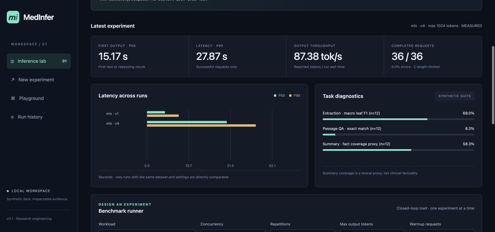
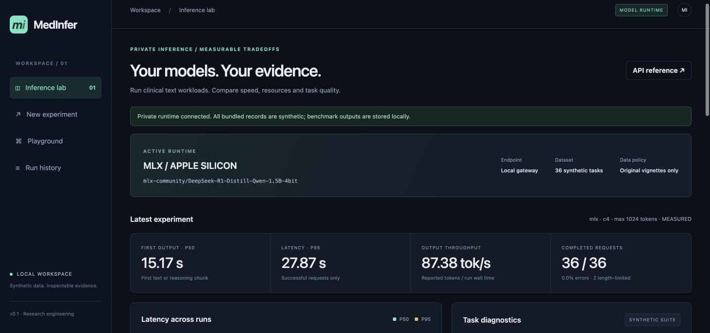

# MedInfer

**面向医疗文本的开源大模型私有化推理与 Benchmark 平台**
供个人临床科研与推理工程实验使用。

[English](README.md) · [架构](docs/architecture.md) · [部署](docs/deployment.md) · [评测方法](docs/benchmark.md) · [验证记录](docs/validation.md)



MedInfer 将 MLX、Ollama、vLLM 的流式推理映射为统一 Backend Interface，提供 FastAPI OpenAI-compatible chat API，在合成医疗文本上记录性能、任务输出与评分，并通过 SQLite 和网页保存可检查的证据。底层推理由成熟运行时完成，项目本身没有实现 DeepInfer、大规模分布式推理或新的推理内核。

## 已完成与验证边界

- **真实运行**：Apple M5 / 16 GB 上的 DeepSeek-R1-Distill-Qwen-1.5B 四位量化 MLX 推理；并发 1/4 各 36 请求；真实 HTTP 下 OpenAI SDK 流式及非流式调用。
- **工程实现**：Ollama NDJSON、vLLM SSE 适配；统一接口；FastAPI；网页；SQLite；JSON/CSV；TTFT、tokens/s、P50/P95、请求吞吐、RSS/Metal 资源指标与可选本地 NVIDIA 采样。
- **测试通过**：37 项自动化测试，在本机及干净环境中通过；[GitHub Actions](https://github.com/teafei/medinfer/actions/runs/40207616589) 的 Python 3.11 / 3.12 / 3.13 三组均为 37 项通过，Docker 构建、启动及鉴权接口检查通过。
- **尚未实跑**：真实 Ollama、NVIDIA/vLLM、7B/14B/32B 对照。相关接口、部署文档和工作流已经提供，不能写成已验证成果。

原始数据为 **12 个原创合成病例 × 3 类任务，共 36 项**，没有真实患者记录。任务共享病例，并非 36 位独立患者。QA 是根据原文作答，不是临床知识考试；摘要指标是词汇代理指标，不是临床事实性认证。本项目不用于诊疗决策。

## 运行

建议 Python 3.12，安装 [uv](https://docs.astral.sh/uv/) 后在项目目录执行：

```bash
# 不下载模型，先体验网页；界面明确显示 SIMULATED
uv sync --locked --extra dev
uv run medinfer --backend mock serve

# Apple Silicon 真实推理
uv sync --locked --extra dev --extra mlx
uv run medinfer --backend mlx \
  --revision 933185be1b8f81d9a21dcfa15ff73470d3545240 serve
```

打开 **http://127.0.0.1:8000**。默认 MLX 模型为 `mlx-community/DeepSeek-R1-Distill-Qwen-1.5B-4bit`；首次推理下载并加载模型。通过 `HF_HOME` 可指定缓存位置。大模型需要显式选择，内存不足时不强行加载。模型权重不会进入仓库。

```bash
# 先停止网关，或通过 --db 使用不同的数据库
uv run medinfer --backend mlx \
  --revision 933185be1b8f81d9a21dcfa15ff73470d3545240 \
  benchmark --concurrency 1 --max-tokens 1024 --warmup 1 \
  --output results/mlx-c1.json

uv run python scripts/verify_evidence.py
uv run pytest -q
```

`--backend`、`--model`、`--base-url`、`--db`、`--revision` 写在子命令前。当前每个网关进程服务一个配置模型，更换配置并重启即可切换后端/模型，历史结果保留。Ollama、vLLM、Docker 和云 GPU 预算见[部署文档](docs/deployment.md)。

## 本机实测

2026-10-25；Apple M5 / 16 GB；macOS 27.0.1；MLX 0.32.4 / MLX-LM 0.32.2；模型快照 `933185be1b8f81d9a21dcfa15ff73470d3545240`。每轮相同的 36 个任务，温度 0、seed 42、warmup 1 次不计入统计，最大输出 1,024 token。

| 并发 | 执行成功 | TTFT 中位数 | 延迟中位数 | P95 延迟 | 整轮输出 token/s | 截断 |
|---:|---:|---:|---:|---:|---:|---:|
| 1 | 36/36 | 0.106 秒 | 4.623 秒 | 8.139 秒 | 97.87 | 2 |
| 4 | 36/36 | 15.166 秒 | 20.442 秒 | 27.871 秒 | 87.38 | 2 |

这是单轮诊断记录。当前 MLX 后端串行生成，并发 4 增加了后端排队，不能把它包装成 GPU 并行加速。两轮均生成 16,125 个运行时报告的 completion token，包含思考。整轮吞吐按测量窗口计算，并非 GPU 内核解码速度。RSS 采样峰值为 1.327 / 1.265 GB，Metal 分配峰值均为 1.263 GB；两者口径不同，不能相加。

任务结果如实保留：抽取宏平均 leaf F1 **0.690**，schema 合法率 **75%**；严格 QA exact match **1/12**；摘要词汇事实覆盖代理 **0.583**。两条摘要耗尽预算后仍停留在思考阶段，没有作为答案计分。QA 的最短答案格式失败不等同于医学知识错误；这些分数不能证明临床能力。



[c1 原始记录](evidence/mlx-m5-c1.json) · [c4 原始记录](evidence/mlx-m5-c4.json) · [评测定义及局限](docs/benchmark.md)

## 交付材料

- [20 天计划及当前进度](docs/20-day-plan.md)
- [简历项目描述](docs/resume.md)
- [技术讲解与面试检查指南](docs/interview-guide.md)
- [三分钟演示脚本](docs/demo-script.md)
- [依赖与来源记录](docs/third-party-reuse.md)
- [本机测试和未验证事项](docs/validation.md)
- [GitHub 发布与验证状态](docs/publishing.md)

公开仓库为 [teafei/medinfer](https://github.com/teafei/medinfer)，本地保留完整 Git 仓库。CI 以 Actions 的实际运行状态为准。代码采用 MIT 许可证；模型和运行时遵循各自许可证。项目使用 AI 辅助开发，可检查代码与真实运行证据。
