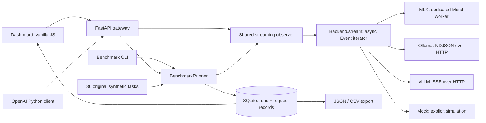

# Architecture

MedInfer is a personal inference engineering lab for clinical text workloads. It delegates model execution to established runtimes and owns protocol translation, measurement, task scoring, persistence and presentation.

## Execution model

- `backends/base.py`: common `Event` contract: answer text, reasoning, provider token counts, finish reason and resource metadata. Missing counts remain `null`.
- `backends/mlx.py`: lazy model load, standard architecture and safetensors, remote tokenizer code disabled. A dedicated single-thread executor owns model and Metal state. An async lock serializes generation. Cancellation is cooperative at generation steps; a running Metal kernel cannot be forcibly stopped.
- `backends/http.py`: translates Ollama NDJSON and vLLM SSE into the same events. Explicit finish markers are required; connection loss does not become a successful short completion. Proxies inherited from the shell are disabled for upstream requests.
- `backends/reasoning.py`: R1 thinking tags can be split across chunks; a template may already include the opening tag. Thinking never becomes a scored answer in the MLX adapter.
- `benchmark/engine.py`: monotonic client-side timing and bounded, closed-loop concurrency. Tasks wait outside an admission semaphore; their admission wait is recorded separately. A backend may add its own queue, included in request latency.
- `benchmark/storage.py`: each finished request is committed immediately; run completion/failure is recorded separately. SQLite uses WAL. The service marks old unfinished runs interrupted on restart. CLI and server should use separate DB files while running simultaneously.
- `api.py`: one experiment or playground request at a time avoids cross-experiment contamination. Benchmark requests inside an experiment can still run concurrently. Single Uvicorn worker only; this is not a distributed scheduler.

## API boundary

`GET /health` is liveness. `GET /api/status` checks backend availability (MLX availability means dependencies are installed; weights load lazily). `GET /v1/models` exposes the configured model. `POST /v1/chat/completions` implements the text chat subset, streaming and optional usage chunks. Unknown fields are rejected. Tools, images, embeddings, logprobs, Responses API and dynamic model hot swapping are outside v0.1. Switch backend/model through CLI flags or environment and restart; historical runs remain comparable in the dashboard.

The HTTP API follows OpenAI chat response and SSE shapes; real OpenAI SDK tests cover streaming and nonstreaming. `reasoning_content` and `medinfer_metrics` are extensions. TTFT includes reasoning; `first_content_s` is the first answer-content chunk for structured reasoning adapters. Raw inline thinking from an upstream without reasoning parsing requires special care.

## Privacy and deployment boundary

The repository contains only original fictional vignettes. Playground inputs are processed in memory, not persisted by MedInfer. Benchmark outputs are persisted because the runner accepts only the bundled synthetic suite. Upstream services may have their own logs; inspect their settings before using other data. No telemetry or public CDN is used by the dashboard. FastAPI's optional documentation UI uses its default documentation assets.

Loopback is the CLI default. Network binds require a gateway API key. Keys are supplied through environment variables, never stored in a run. Upstream URLs cannot be selected through browser input. The dashboard uses text nodes, not HTML injection, for model outputs. Production medical use, audit compliance and multi-tenant access control are not claimed.
